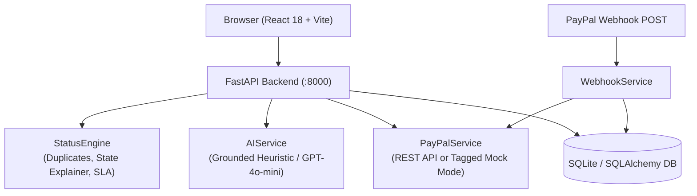

# Architecture — PayPal Transaction Resolution Copilot

## System Overview

The PayPal Transaction Resolution Copilot is a full-stack application combining a React 18 / Vite frontend and a FastAPI / SQLAlchemy backend. The primary workflow focuses on **transaction resolution**: explaining verified payment states, rendering database-backed payment event timelines, detecting possible duplicate payments, and generating grounded support summaries. Dispute tracking and SLA cases remain integrated as a secondary workflow.

---

## Component Architecture

---

## Database Schema

Five SQLAlchemy tables (`backend/models.py`):

- **`transactions`** — Core payment records (`id`, `paypal_transaction_id`, `merchant_id`, `amount`, `currency`, `status`, `description`, `buyer_email`, `seller_email`, `metadata`, `created_at`, `updated_at`).
- **`transaction_events`** — Real payment timeline entries (`id`, `transaction_id` FK, `event_type`, `title`, `description`, `source`, `details`, `occurred_at`).
- **`disputes`** — Linked PayPal disputes (`id`, `transaction_id` FK, `paypal_dispute_id`, `reason`, `status`, `evidence_submitted`, `resolution`, timestamps).
- **`resolution_cases`** — Agent dispute cases & SLA tracking (`id`, `dispute_id` FK, `assigned_agent`, `priority`, `ai_recommendation`, `steps_taken`, `outcome`, timestamps).
- **`webhook_events`** — Idempotent webhook log (`id`, `event_type`, `payload`, `verification_status`, `processing_status` [`PROCESSING`/`PROCESSED`/`UNHANDLED`/`FAILED`], `error_message`, `processed`, `received_at`, `processed_at`).

---

## Grounded AI & Mock Mode Guarantees

1. **Deterministic Evidence Authority (`status_engine.py`, `ai_service.py`)**:
   - `StatusEngine.explain_transaction_state()` computes authoritative `source_evidence`, `verified_fields_used`, partial/full refund totals (`get_refund_summary`), dispute statuses/evidence states, stale webhook counts, and explicit `unavailable_fields`.
   - `AIService.explain_transaction()` and `generate_support_summary()` treat free-text transaction strings (`metadata`, `description`, `buyer_email`, `timeline_events`, `agent_notes`) as untrusted data, validate any OpenAI rewrite with `_check_grounding_compliance()` before accepting it, keep `source_evidence` / `verified_facts` strictly from backend records, and fall back to deterministic heuristic mode on missing/invalid API keys, timeouts (`15s`), rate limits (`429`), or validation failures.
   - Explanation endpoints are strictly read-only on `Transaction` rows and never trigger PayPal refunds.
2. **Explicit Mock Labeling (`paypal_service.py`)**:
   - When `PAYPAL_CLIENT_ID` or `PAYPAL_CLIENT_SECRET` are unset/placeholders, `PayPalService` runs in mock mode.
   - Every mock response includes `"mode": "mock"`, `"is_simulated": true`, `"data_source": "mock_paypal_api"`, and `"warning"`.
   - Unknown IDs return `404` rather than fabricating simulated `"COMPLETED"` records.

---

## PayPal Webhook Verification & Reconciliation (`webhook_service.py`)

PayPal webhooks are **never** validated with a local HMAC secret. Instead:

- When `PAYPAL_VERIFY_WEBHOOKS=true` (recommended for Sandbox/Live), `WebhookService.verify_webhook_signature()` validates that `PAYPAL-CERT-URL` is an HTTPS `*.paypal.com` URL and delegates verification to PayPal's official `POST /v1/notifications/verify-webhook-signature` endpoint with all 5 required `PAYPAL-*` transmission headers plus `PAYPAL_WEBHOOK_ID`. Requests are sent via `_post_raw_json()` with the original raw request bytes preserved verbatim inside `"webhook_event"`, and rejected with `401` unless PayPal returns `verification_status == "SUCCESS"`.
- When `PAYPAL_VERIFY_WEBHOOKS=false` in local dev/mock mode, verification is explicitly skipped and logged in `webhook_events.verification_status` as `"skipped_dev_mode"`.
- **Reliability & State Guards**: Events are claimed atomically via SQLite primary key uniqueness on PayPal's event ID, rejected with `400` if `id` or `event_type` is missing, marked `FAILED` (preserving retryability) if a handler fails, reconciled by `refund_id` (`record_refund_state()`) to support partial refunds without double-counting, and guarded by `is_valid_webhook_status_transition()` so stale/out-of-order `PENDING` or `COMPLETED` webhooks cannot overwrite newer states (`REFUNDED`, `DISPUTED`, `COMPLETED`).

---

## Security & Git Hygiene

- `.gitignore` excludes `.env`, `.env.local`, `.env.*.local`, `copilot.db`, `*.db`, `*.sqlite*`, `venv/`, `node_modules/`, and `dist/`.
- `.env.example` contains only placeholder keys.
- All backend secrets remain strictly server-side; the React frontend communicates only with the FastAPI backend.
